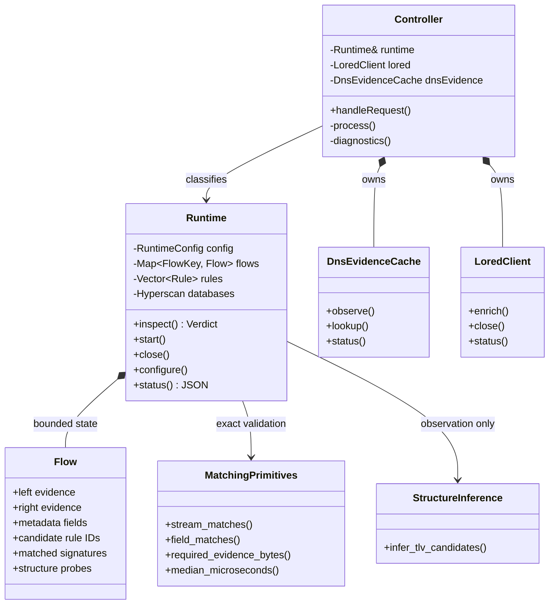

# Sift architecture

Sift is a stateful, content-first traffic classifier. The daemon accepts
connection lifecycle events and payload chunks, accumulates bounded evidence
per flow, evaluates compiled YAML signatures and returns a JSON verdict.

## System at a glance

```text
                         build time
  signatures/default.yaml ──> compile_signatures.py ──> compiled_signatures.hpp
                                                               │
                                                               v
                         runtime                         +---------------+
  Smithproxy / client ── HTTP or SXBN ──> Controller ──>│    Runtime    │
                                           │            │               │
                                           │            │  Hyperscan    │
                                           │            │      +        │
                                           │            │ exact matchers│
                                           │            +-------+-------+
                                           │                    │
                         +-----------------+---------+          │
                         │                           │          v
                  DnsEvidenceCache              LoredClient   Verdict
                  local correlation          optional lookup     │
                         │                           │             │
                         +---------------------------+-------------+
                                                     │
                                                     v
                                              JSON response
```

The HTTP layer coordinates the request. Classification remains inside
`Runtime`; DNS and LoreD only add explicitly reported evidence or enrichment.

## Request flow

```mermaid
flowchart LR
    Client[Smithproxy or API client]
    HTTP[HTTP Controller]
    Decode[JSON / SXBN decoder]
    Identity[Flow identity resolver]
    Metadata[Inspection metadata parser]
    DNS[DNS evidence cache]
    Runtime[Classification runtime]
    LoreD[Optional LoreD enrichment]
    Reply[JSON verdict]

    Client --> HTTP --> Decode --> Identity --> Metadata
    Metadata --> DNS
    DNS --> Runtime
    Runtime --> LoreD
    LoreD --> Reply
    Runtime --> Reply
```



1. `Controller` bounds the request body and selects the API endpoint.
2. Connection-content requests are decoded from JSON or the binary-safe
   `SXBN001` envelope.
3. `resolve_identity()` builds a tenant/instance/session flow key.
4. The metadata parser extracts payload layer information, L7 ranges and
   trusted `flow.*` observations.
5. Forward DNS evidence may add correlated hostnames to the metadata.
6. `Runtime::inspect()` updates flow state and evaluates signatures.
7. LoreD is queried only when the request explicitly asks for it.

## Main components



## Signature evaluation

```text
incoming bytes
     │
     ├─> append bounded per-side evidence
     │
     ├─> Hyperscan streaming prefilter
     │       └─> candidate rule IDs
     │
     ├─> exact stream/field matchers
     │       ├─ byte and prefix checks
     │       ├─ framed integer and length checks
     │       ├─ TLS, QUIC and BER structure checks
     │       └─ metadata/hostname checks
     │
     └─> stable signature matches in Verdict
```

Hyperscan is a candidate accelerator, not the final authority. A candidate is
reported only after every YAML clause passes its exact matcher. Rules without
candidate regexes are evaluated directly against accumulated fields and bytes.

## Source map

| Area | Files | Responsibility |
|---|---|---|
| Process entry | `src/main.cpp` | CLI, signals and daemon startup |
| HTTP adapter | `src/server.cpp` | Endpoints, decoding and orchestration |
| Runtime | `src/engine.cpp`, `include/sift/engine.hpp` | Flow lifecycle and verdicts |
| Matchers | `src/matching.cpp`, `src/matching.hpp` | Stateless matching primitives |
| Identity | `src/identity.cpp` | Tenant/instance/session isolation |
| DNS evidence | `src/dns_evidence.cpp` | Bounded forward-DNS correlation |
| LoreD | `src/lored.cpp` | Optional, cached external enrichment |
| Structure inference | `src/structure.cpp` | Experimental TLV observations |
| Envelope | `src/sxbn.cpp` | Binary-safe request decoding |
| Signature source | `signatures/default.yaml` | Production classification policy |

## State and concurrency

```text
Controller request threads
        │
        ├─ Runtime mutex ───── flows, scanners, counters, configuration
        ├─ DNS cache mutex ─── observations and expiry
        └─ LoreD mutex ─────── per-flow and shared query caches
```

Evidence and caches are explicitly bounded. Flow expiry, capacity eviction and
late-event tombstones protect the daemon when lifecycle callbacks are missing
or reordered. External LoreD calls are performed outside its cache lock.

## Design boundaries

- Protocol and application knowledge belongs in YAML, never in the runtime.
- C++ matchers implement reusable mechanics, not individual product identities.
- Requestor metadata has no effect unless a YAML rule names its exact field.
- `enc.*` results identify conclusions derived from encrypted-layer evidence.
- Structure inference is observational and does not publish protocol verdicts.
- DNS and LoreD enrichment never silently replace the core Sift verdict.
